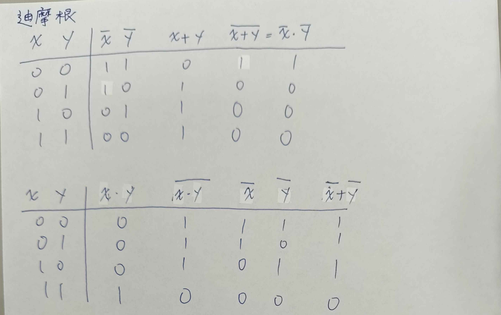
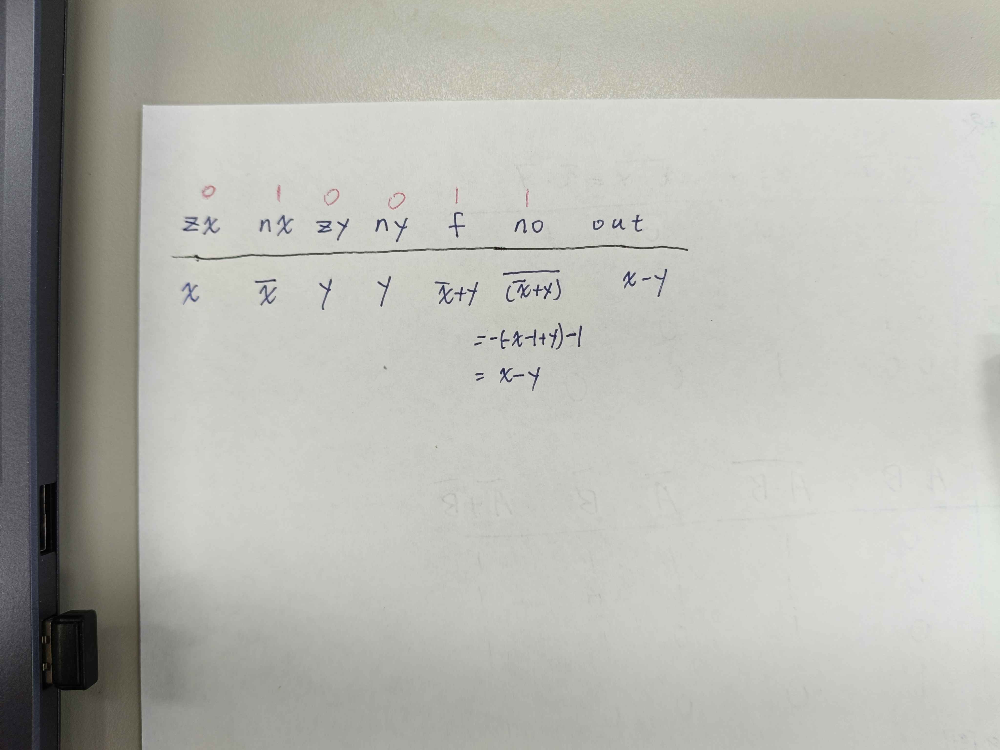
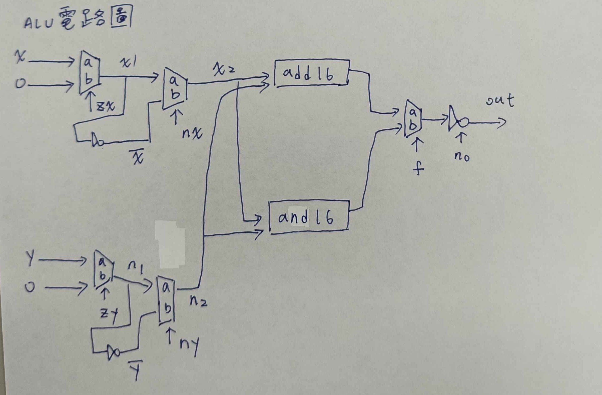
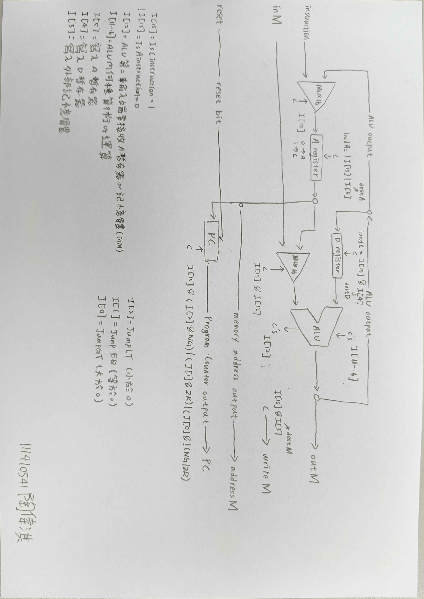

每週檢驗表格

第幾週 |  習題內容 | 有上課且準時繳交 |  補交且附上請假證明 | 作業連結
-------|----------|--------------------|---------------------|-------------
3          | 第 1, 2 章   |   是 |   | [01](https://github.com/TAO933/111410541-1/tree/main/01), [02](https://github.com/TAO933/111410541-1/tree/main/02)
4          | 第3 章除 PC | 是 |      |  [03](https://github.com/TAO933/111410541-1/tree/main/03) | 
5          | 第 4 章 | 是 |  |  [04](https://github.com/TAO933/111410541-1/tree/main/04) | 
6          | HackCPU 電路圖 | 是 |  | | 
7          | 第 5 章 | 是 |  |  [05](https://github.com/TAO933/111410541-1/tree/main/05) | 
8          | EDA 軟體報告 | 是 |   | | 


# 第三週：請完成第 1, 2 章所有習題
### 第一章所有習題:
- 基本邏輯閘:典型的電腦架構是基於一組基本邏輯閘，例如 And, Or, Mux, etc等，以及它們的位元運算版本，例如 And16、Or16、Mux16 等，在這個專案中，你將建立一組典型的基本邏輯閘。這些邏輯閘構成了建構電腦 CPU 和 RAM 晶片的基本模組，在後續專案中，你將使用這些模組來建立電腦的 CPU 和 RAM 晶片。

     - Nand (given)  
Not  
And  
Or  
Xor  
Mux  
DMux  
Not16  
And16  
Or16  
Mux16  
Or8Way  
Mux4Way16  
Mux8Way16  
DMux4Way  
DMux8Way  

* https://github.com/TAO933/111410541-1/tree/main/01

### 第二章所有習題:
- 任何電腦架構的核心都是其CPU，即中央處理器，而CPU的運算核心則是ALU，也就是算術邏輯單元。在這個專案中，你將逐步建構一組執行算術加法的晶片，最終完成Hack計算機的ALU晶片的建構。在此過程中，你將親身實踐，親眼見證如何使用布林邏輯實現有符號數的算術運算。

     - HalfAdder
FullAdder
Add16
Inc16
ALU
* https://github.com/TAO933/111410541-1/tree/main/02

### 請用手寫真值表的方式，證明迪摩根定律

### 證明 ALU 的下列情況 * zx=0, nx=1, zy=0, ny=0, f=1, no=1 時，out = x-y

### 請手繪 ALU 的電路圖


---
# 第四週：請完成第 3 章除了 PC 以外的所有習題
### 第三章所有習題
- 電腦的主記憶體，也稱為隨機存取記憶體（RAM），是可定址的暫存器序列，每個暫存器用於儲存一個n位的值。在這個專案中，你將逐步建立一個RAM單元。這涉及兩個主要問題：（i）使用閘電路持久儲存資料位元；（ii）使用閘電路定位（「尋址」）我們需要操作的記憶體暫存器。
    - DFF (given)
Bit
Register
RAM8
RAM64
RAM512
RAM4K
RAM16K
PC
* https://github.com/TAO933/111410541-1/tree/main/03
---
# 第五週：請完成第 4 章所有習題 (mult.asm, fill.asm)
### 第四章所有習題
- 本專案介紹底層機器語言程式設計。您將使用 Hack 彙編語言編寫一些程序，然後使用提供的彙編器（一個翻譯程式）將其翻譯成二進位程式碼，並透過執行來測試生成的二進位程式碼。通常，二進位代碼是在電腦硬體上執行的；由於 Hack 計算機要到下一個專案才會完成，因此在本專案中，您將使用提供的 CPU 模擬器來執行二進位程式碼。 CPU模擬器是一個使用軟體模擬來執行二進位代碼的電腦程式。
* https://github.com/TAO933/111410541-1/tree/main/04
---
# 第六週：請畫出 HackCPU 的電路圖（含邏輯式與符號對應表）


---
# 第七週：請完成第五章習題（CPU+Memory+Computer）
### 第五章所有習題
- 在這個專案中，你將把專案 2 和 3 中建構的 ALU、寄存器和 RAM 裝置整合到一個CPU 和一個能夠執行用專案 4 中介紹的機器語言編寫的程式的電腦系統中。

* https://github.com/TAO933/111410541-1/tree/main/05
---
# 第八週：請使用 IC EDA 軟體後，寫一份報告
- ## EDA 是什麼？IC 設計中的電子設計自動化
### 一、定義

**EDA（Electronic Design Automation，電子設計自動化）** 是指利用電腦軟體工具來輔助積體電路（IC）與電子系統的設計、模擬、驗證、佈局與製造準備的一整套技術與工具。

簡單來說：**EDA 就是把「畫電路、驗證電路、把電路做成晶片」的流程自動化、電腦化的軟體工具鏈。**

一顆現代晶片可能包含數百億個電晶體，若沒有 EDA，工程師根本不可能以人工完成設計與驗證。因此 EDA 被視為半導體產業的「上游關鍵軟體」，與晶圓代工、IP 並列為 IC 設計的三大支柱。

---

## 二、為什麼需要 EDA？

| 挑戰 | EDA 的角色 |
|------|-----------|
| 電晶體數量龐大（數十億級） | 自動合成、自動佈局佈線 |
| 設計錯誤成本極高（一次投片數百萬美元） | 在投片前完成模擬與驗證 |
| 製程節點不斷微縮（3nm、2nm） | 處理複雜的物理效應與設計規則 |
| 功耗、效能、面積（PPA）需最佳化 | 自動化最佳化與分析 |
| 產品上市時間壓力 | 縮短設計週期、提高重複使用性 |

---

## 三、IC 設計流程與對應的 EDA 工具

IC 設計大致可分為 **前端（Front-End）** 與 **後端（Back-End）** 兩大部分。

### 1. 系統規格與架構設計
- 定義晶片功能、效能目標、功耗預算
- 工具：系統層模擬、架構探索工具（如效能模型、Virtual Platform）

### 2. RTL 設計（Register Transfer Level）
- 使用 **Verilog / VHDL / SystemVerilog** 描述電路行為
- 工具：文字編輯器、IDE、Lint 工具（語法與風格檢查）

### 3. 功能模擬（Simulation）
- 驗證 RTL 行為是否符合規格
- 工具：Synopsys VCS、Cadence Xcelium、Siemens Questa/ModelSim
- 搭配驗證方法：UVM、Formal Verification、Coverage 分析

### 4. 邏輯合成（Logic Synthesis）
- 將 RTL 轉換成閘級電路（Gate-Level Netlist）
- 對應到特定製程的標準元件庫（Standard Cell Library）
- 工具：Synopsys Design Compiler、Cadence Genus

### 5. 時序分析（Static Timing Analysis, STA）
- 檢查電路在所有條件下能否在時脈週期內完成運算
- 工具：Synopsys PrimeTime、Cadence Tempus

### 6. 實體設計（Physical Design）
包含下列步驟：
- **Floorplanning**：規劃晶片區塊位置
- **Placement**：擺放標準元件
- **Clock Tree Synthesis（CTS）**：建立時脈樹
- **Routing**：繞線連接元件
- **DRC / LVS**：設計規則檢查與電路佈局比對

工具：Synopsys IC Compiler II、Cadence Innovus、Siemens Calibre（DRC/LVS）

### 7. 寄生參數萃取與簽核（Sign-off）
- 萃取佈局後的電阻、電容（RC Extraction）
- 重新做時序、功耗、IR Drop、EM 分析
- 工具：Synopsys StarRC、PrimeTime、Cadence Quantus、Voltus

### 8. 光罩製作與製造（Tape-out）
- 產出 GDSII 檔案交給晶圓代工廠
- 工具：EDA 流程最終輸出與格式轉換

---

## 四、EDA 的主要工具類別

| 類別 | 功能 | 代表工具 |
|------|------|---------|
| 模擬器（Simulator） | 驗證 RTL 功能 | VCS、Xcelium、Questa |
| 合成（Synthesis） | RTL → 閘級電路 | Design Compiler、Genus |
| 實體設計（P&R） | 擺放與繞線 | IC Compiler II、Innovus |
| 時序分析（STA） | 時序簽核 | PrimeTime、Tempus |
| 實體驗證（DRC/LVS） | 佈局正確性檢查 | Calibre、PVS |
| 形式驗證（Formal） | 數學證明等效性 | Formality、Conformal |
| 功耗分析 | 功耗估算與最佳化 | PrimePower、Voltus |
| PCB 設計 | 電路板佈局 | Altium Designer、KiCad、Cadence Allegro |

---

## 五、主要 EDA 廠商

- **Synopsys**：全球最大 EDA 廠商，涵蓋模擬、合成、實體設計、IP
- **Cadence**：第二大廠，類比/混合訊號與數位流程皆強
- **Siemens EDA（原 Mentor Graphics）**：Calibre 為 DRC/LVS 業界標準
- **Ansys**：電源完整性、熱分析、電磁模擬
- 開源工具：**KiCad**（PCB）、**OpenROAD**、**Yosys**（學術/開源 IC 流程）

---

## 六、EDA 與其他領域的關係

```
IC 設計 = 電路知識 + EDA 工具 + IP 智財 + 晶圓代工
```

- **IP（Intellectual Property）**：可重複使用的電路模組（如 CPU 核心、USB 控制器）
- **Foundry**：提供製程設計套件（PDK）與標準元件庫，EDA 需與其配合
- **EDA**：串接設計、驗證與製造的橋樑

三者形成半導體產業的核心生態系。

---

## 七、總結

- EDA 是 IC 設計不可或缺的軟體工具鏈，負責從 **概念 → RTL → 閘級 → 佈局 → 光罩** 的每一個環節。
- 沒有 EDA，就不可能設計出現代動輒數十億電晶體的晶片。
- 對學習者而言，建議先熟悉 **Verilog/SystemVerilog** 與基本數位邏輯，再接觸模擬器與合成工具，最後理解實體設計流程。
- 想入門可先使用開源工具（Yosys、OpenROAD、Verilator）建立完整觀念，再進到業界商用工具。

---


